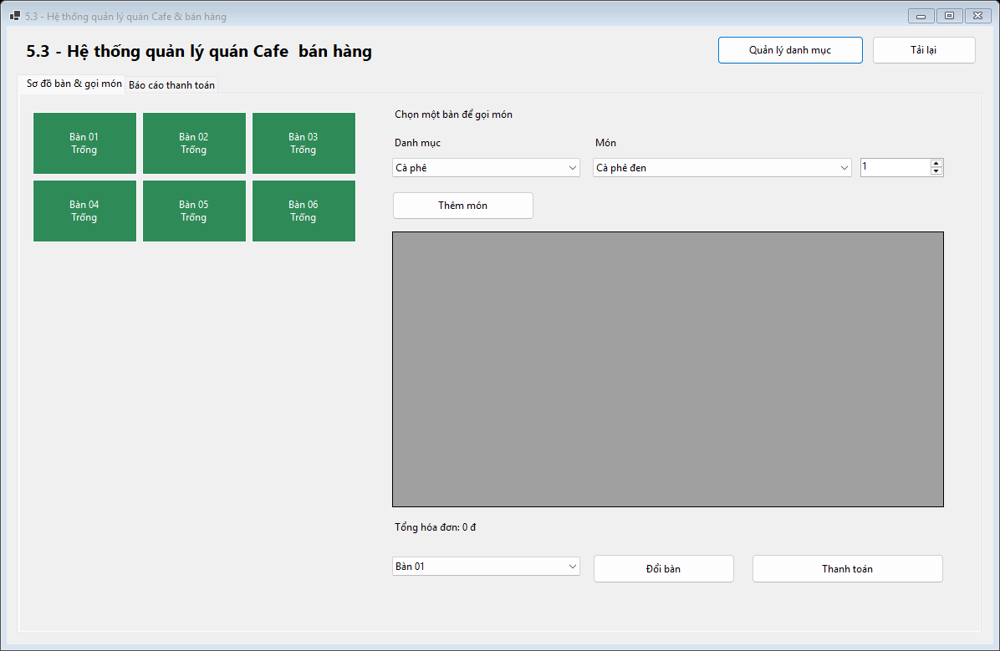
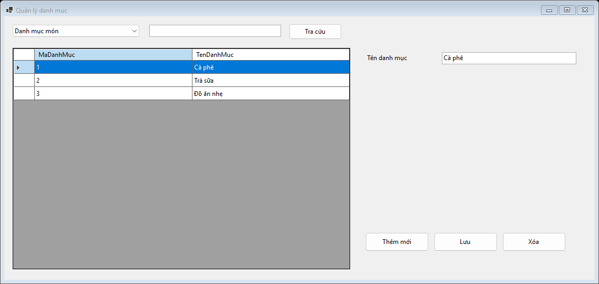
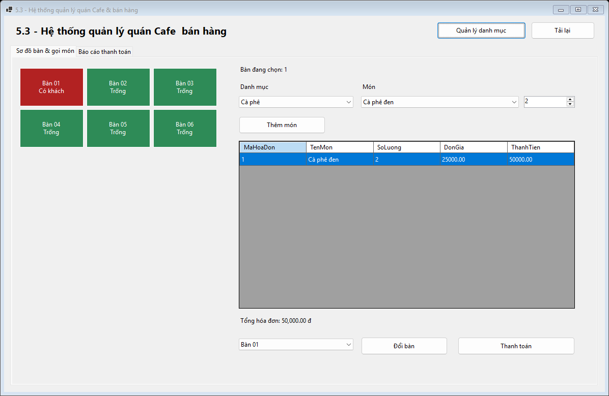
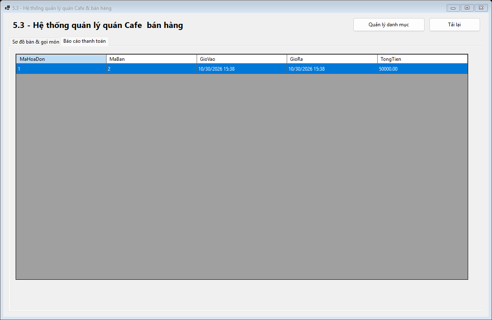
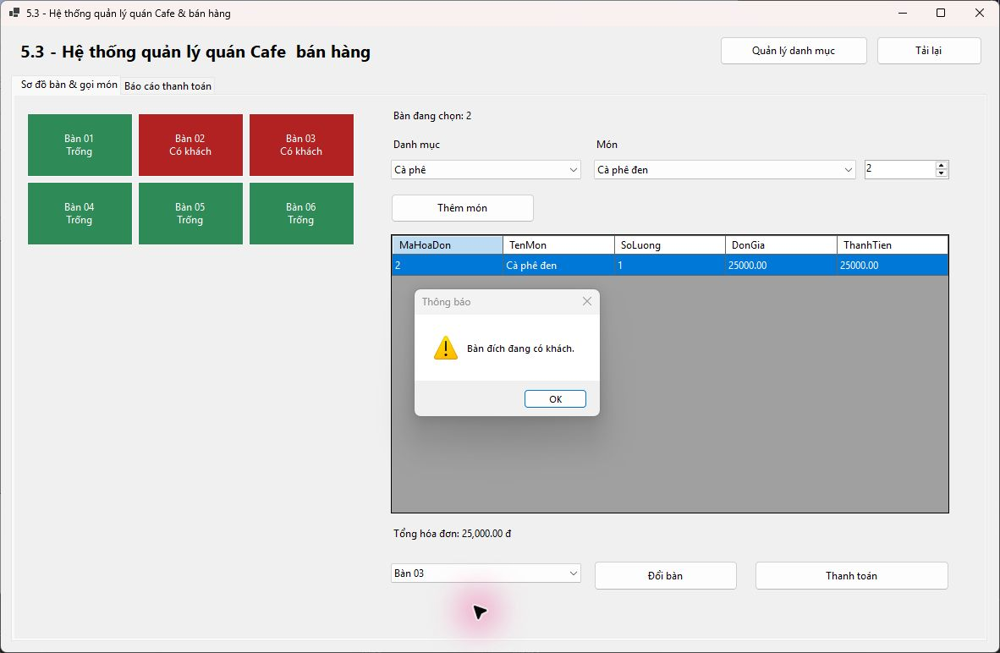

# Bài tập 5.3 – Hệ thống quản lý quán Cafe & bán hàng

## Mục 1: Thông tin sinh viên

- Họ và tên sinh viên: Phạm Tuấn Thành
- Mã sinh viên: 24810320264
- Tên đề tài / bài tập: Bài tập 5.3 – Hệ thống quản lý quán Cafe & bán hàng

## Mục 2: Hướng dẫn cài đặt & chạy dự án

Yêu cầu: Windows, Visual Studio 2022 có workload **.NET desktop development** và .NET 8 SDK, SQL Server và SQL Server Management Studio (SSMS).

1. Mở SSMS, kết nối SQL Server của máy, mở và chạy toàn bộ [Database/ScriptDB.sql](Database/ScriptDB.sql) để tạo CSDL `CafePOSDB` và dữ liệu mẫu.
2. Mở [CafePOS.sln](CafePOS.sln) bằng Visual Studio 2022, chờ khôi phục các gói NuGet.
3. Mở [CafePOS/DAL/DatabaseHelper.cs](CafePOS/DAL/DatabaseHelper.cs), sửa `ConnectionString` theo máy cá nhân. Ví dụ với SQL Server Express dùng Windows Authentication:

   ```csharp
   @"Server=.\SQLEXPRESS;Database=CafePOSDB;Integrated Security=true;Encrypt=true;TrustServerCertificate=true;Connect Timeout=15"
   ```

   `Server` phải trùng máy chủ đã chạy script trong SSMS. Cấu hình mặc định dùng instance LocalDB `(localdb)\LTNET_BT5_SQL`; chỉ giữ nguyên khi máy đã có instance này.
4. Build và chạy bằng **F5**. Để mở Design View, chọn `GUI/MainForm.cs` hoặc `GUI/CatalogForm.cs` trong Solution Explorer rồi nhấn **Shift+F7**.

## Mục 3: Hình ảnh kết quả các màn hình chức năng

### 1. Màn hình chính / Tổng quan



### 2. Quản lý danh mục / Thêm, sửa, xóa (CRUD)



### 3. Thực thi nghiệp vụ chính – Gọi món



### 4. Báo cáo – Thống kê



### 5. Báo lỗi giao dịch đổi sang bàn đã có khách


